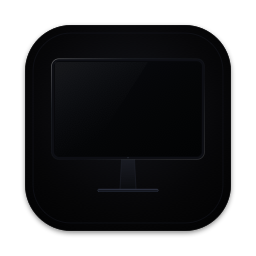
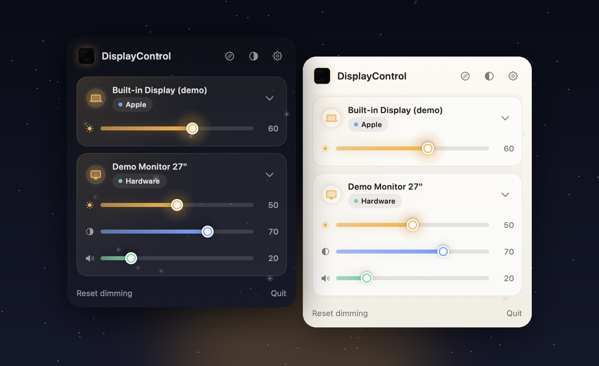
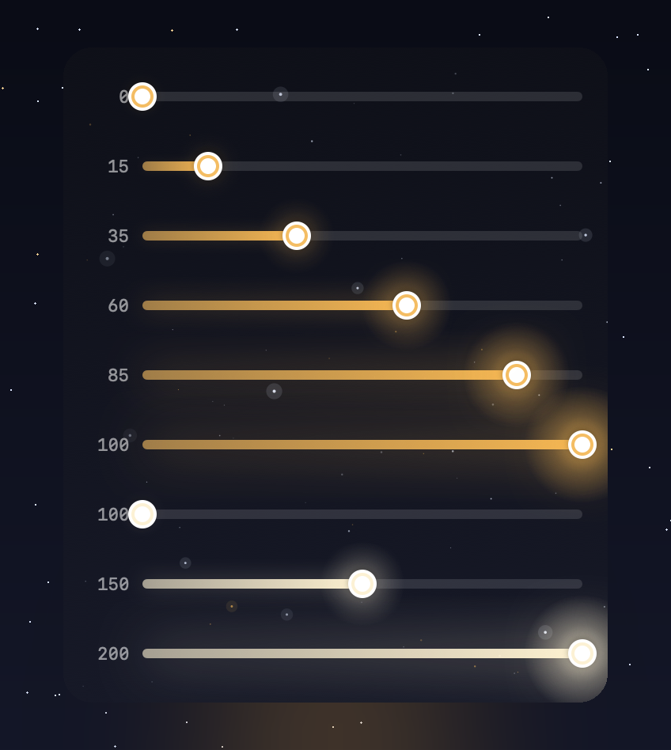
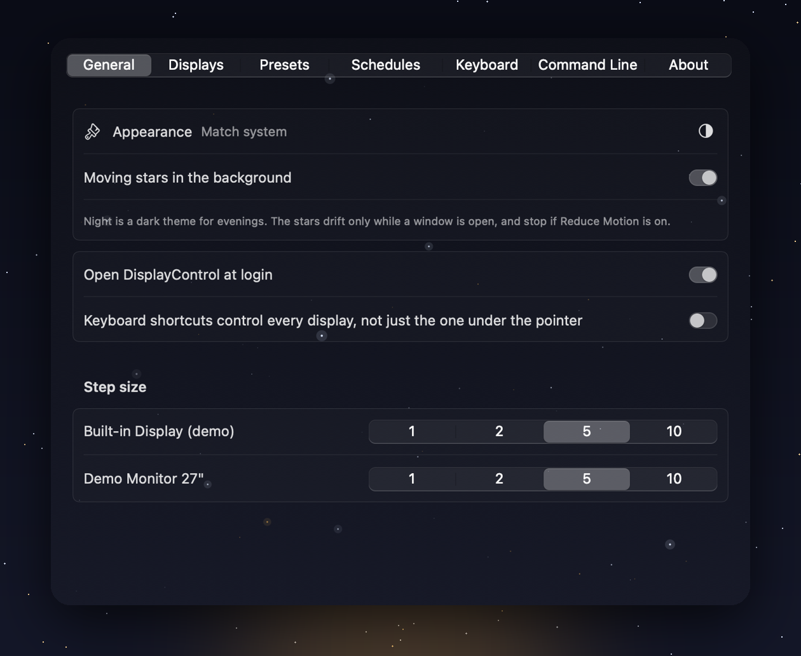
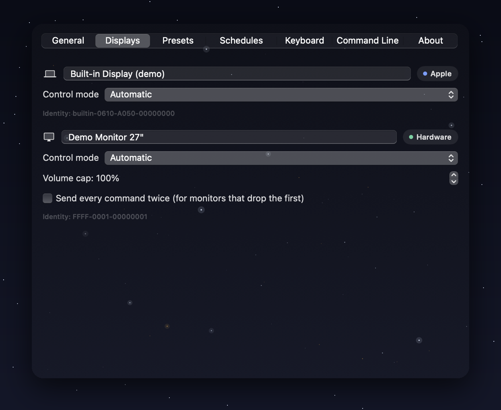
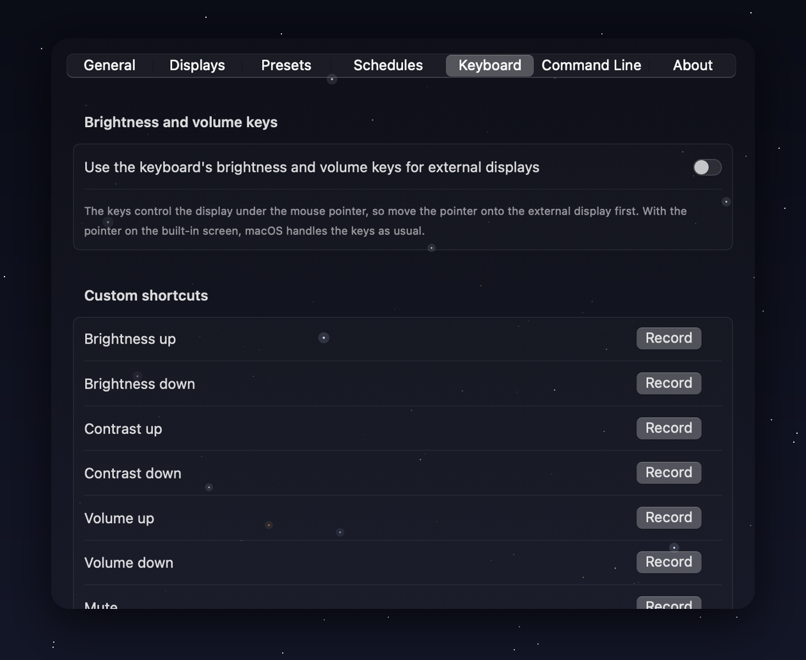

<div align="center">



# DisplayControl

### Your Mac's brightness keys, for every monitor.

Real hardware brightness, contrast, volume and input for external displays.<br>
Sync them. Save setups. Let your screens follow your day.


<br>



</div>

<br>

## Why this matters

Most people spend 8 or more hours a day looking at a screen, and the screen you look at most is often an external monitor. macOS gives you a brightness slider for your laptop and for Apple displays, but for most other monitors you are left with a few tiny, unlabeled buttons on the back or underside.

That small gap quietly costs you every day:

- 👀 **Tired eyes.** A monitor that is far brighter than the room is a classic cause of eye strain and headaches. Being able to dim it in one second, at any hour, changes how your evenings feel.
- 🌗 **Mismatched screens.** A laptop at 60% beside a monitor at 100% looks wrong, and your eyes keep re-adjusting between them. Sync makes them behave like one display.
- 🌙 **Late nights.** Dimming by hand every evening means you forget. Schedules do it for you at sunset.
- ⏱️ **Wasted time.** Digging through a monitor's menu to switch an input or turn the volume down is a small annoyance you repeat hundreds of times. A key press replaces it.
- 🎬 **One desk, many moods.** Work, a movie and a game want different brightness, volume and inputs. One click should switch all of them.

DisplayControl exists to make external monitors feel as built in as your MacBook screen: instant, quiet and always within reach.

<br>

## Stop reaching behind your monitor

Monitor buttons are tiny, unlabeled and hidden. Your laptop screen glows at one brightness while your external display blazes at another. It is 11 pm and one screen is still blinding.

**DisplayControl fixes all of it from your menu bar.** It talks to your monitor the same way its own buttons do (DDC/CI), so you change the *real* backlight, not just a dimmed picture.

<br>

## See it in action

<div align="center">

**The menu bar window, in Night and Light**


<br><br>

**Sliders that glow with your brightness**

Brighter as you raise it, softer as you lower it, and nearly white when you push past 100% with extra brightness.



<br><br>

**Make it yours**



<br><br>

**Know and tune every display**



<br><br>

**Your keys, your shortcuts**



</div>

<br>

## Set up in three minutes (no experience needed)

You do not need to know anything about code. Pick **one** of these two ways. Both do the same thing: they build DisplayControl for you and put it in your **Applications** folder.

**You need:** a Mac running macOS 13 or newer, and an internet connection for the first install.

### The easiest way: copy and paste one line

1. Press **⌘ Space**, type **Terminal**, and press **Return**. A window with a blinking cursor opens. That is Terminal.
2. Copy this line, paste it into Terminal (**⌘ V**) and press **Return**:

   ```bash
   curl -fsSL https://raw.githubusercontent.com/ma67-ex/DisplayControl/main/install.sh | bash
   ```

3. Wait about three minutes while it works. It tells you what it is doing at every step.
   - If a window from Apple pops up asking to install **developer tools**, click **Install**, wait for it to finish, then run the line in step 2 again. This happens only once.
4. When you see **All done**, DisplayControl is installed and open.

### The point and click way: download and double-click

1. At the top of this page click the green **Code** button, then **Download ZIP**.
2. Open your **Downloads** folder and double-click the ZIP to unpack it.
3. Open the new **DisplayControl** folder. **Right-click** the file **Install DisplayControl** and choose **Open**, then click **Open** again if macOS asks. (Right-clicking is only needed the first time.)
4. A window opens and does everything. When it says **All done**, you are finished. Press any key to close it.

### Your first minute

A little **display icon** now sits at the top right of your screen. There is no Dock icon, which keeps your desk tidy.

1. **Click the icon.** You will see each of your screens with its own sliders.
2. A short welcome lists your displays. Press **Test** next to a monitor to try it. It nudges the brightness a little, checks it worked and puts it back.
3. Drag a slider and watch your monitor respond.

### Make it yours (all optional)

| You want | Do this |
|---|---|
| **Use your keyboard's brightness and volume keys** | Click the icon, then the **gear**. Open **Keyboard**, switch it on and allow DisplayControl when macOS asks. Move your mouse onto a screen and press the keys. |
| **Start with your Mac** | Click the **gear**, then in **General** switch on *Open DisplayControl at login*. |
| **Match two screens** | Click the **link** button at the top of the window to turn on Sync. |
| **Save a setup** | Gear, **Presets**, *Save current setup*, give it a name. Apply it from the window in one click. |
| **Dim at sunset** | Gear, **Schedules**, add a schedule with the *Sunset* trigger and choose a preset. Add your location once, or type coordinates. |
| **Switch theme** | Click the **half-moon** button in the window to cycle Match system, Light and Night. |
| **Use it from Terminal** | Gear, **Command Line**, press *Install*, then try `displaycontrol status`. |

<details>
<summary><b>For developers: build it by hand</b></summary>

```bash
git clone https://github.com/ma67-ex/DisplayControl.git
cd DisplayControl
./Packaging/build-app.sh
open dist/DisplayControl.app
```

See [docs/DEVELOPMENT.md](docs/DEVELOPMENT.md) for the architecture and tests.
</details>

<br>

## Everything you get

<table>
<tr>
<td width="50%" valign="top">

### 🔆 Real brightness, real control
Brightness, contrast, volume, mute, input source, power, rotation and resolution. Only the controls your monitor truly has show up, so nothing is ever a dead slider.

</td>
<td width="50%" valign="top">

### ⌨️ Your keys just work
Use the brightness and volume keys on whichever display your pointer is on. Or record your own shortcuts for anything.

</td>
</tr>
<tr>
<td valign="top">

### 🔗 One slider, every screen
Turn on **Sync** and the other displays follow. Set an offset so a bright laptop and a dim monitor still look matched.

</td>
<td valign="top">

### 🎛️ One click setups
Save **Work**, **Movie night** or **Gaming** as a preset: brightness, inputs, resolution, even where your screens sit. Apply it in a click.

</td>
</tr>
<tr>
<td valign="top">

### 🌅 Your displays follow your day
Run a preset at a time, at sunrise or sunset, on wake or unlock, when you plug in, or the moment a monitor connects.

</td>
<td valign="top">

### ✨ Extra brightness
Need a brighter picture? Boost lifts the white level up to 200% by scaling your monitor's color gains together, with one tap back to your original look.

</td>
</tr>
<tr>
<td valign="top">

### 🌙 Beautiful in Light and Night
A dark Night theme for evenings, a bright Light theme for days, or match macOS. Brightness sliders *glow*: brighter as you raise them, softer as you lower them.

</td>
<td valign="top">

### 🔒 Private by design
No account. No analytics. No network access at all. Everything stays on your Mac, and a script in the repo proves it.

</td>
</tr>
</table>

<br>

## Built for people who automate

<details>
<summary><b>Command line</b>: script every display</summary>

```bash
displaycontrol status                        # every display at a glance
displaycontrol set "Dell" --brightness 70
displaycontrol set --all --brightness 40     # all displays at once
displaycontrol set "Dell" --input hdmi2
displaycontrol set "Dell" --boost 150        # extra brightness
displaycontrol preset activate "Evening"
displaycontrol sync enable "Dell"
displaycontrol selftest "Dell"               # check a monitor end to end
```

Readable in a terminal, JSON when piped. Install it from **Settings → Command Line**.
</details>

<details>
<summary><b>URL scheme</b>: Shortcuts, Alfred, anything that opens a link</summary>

```bash
open "displaycontrol://preset/Evening"
open "displaycontrol://set?display=Dell&brightness=60"
```
</details>

<details>
<summary><b>AI assistants</b>: built-in MCP server</summary>

Let an assistant dim your screens, switch inputs or apply a preset:

```json
{ "mcpServers": { "displaycontrol": { "command": "/usr/local/bin/displaycontrol", "args": ["mcp"] } } }
```
</details>

<br>

## Light on your Mac

Event driven, with no background polling. On the author's Mac it sits at **0% CPU** when you are not looking at it and uses **about 15 to 25 MB** of memory. The drifting stars in the background only move while a window is open.

## Your data never leaves your device

DisplayControl contains no networking code at all. No accounts, no analytics, no crash reporting, no license server. Settings live in one folder on your Mac and are readable only by you.

Don't take our word for it:

```bash
./Scripts/check-offline.sh
```

It inspects the source, the built programs and the running app, and confirms nothing can reach the internet or your network.

<br>

## Free forever, and open

DisplayControl is released under the **MIT License**. Read it, change it, share it. Issues and ideas are welcome.

<div align="center">

<br>

**If DisplayControl makes your desk nicer, give it a ⭐ so others can find it.**

</div>

<br>

<sub>Developers: see [docs/DEVELOPMENT.md](docs/DEVELOPMENT.md) for the architecture, tests and build details.</sub>
